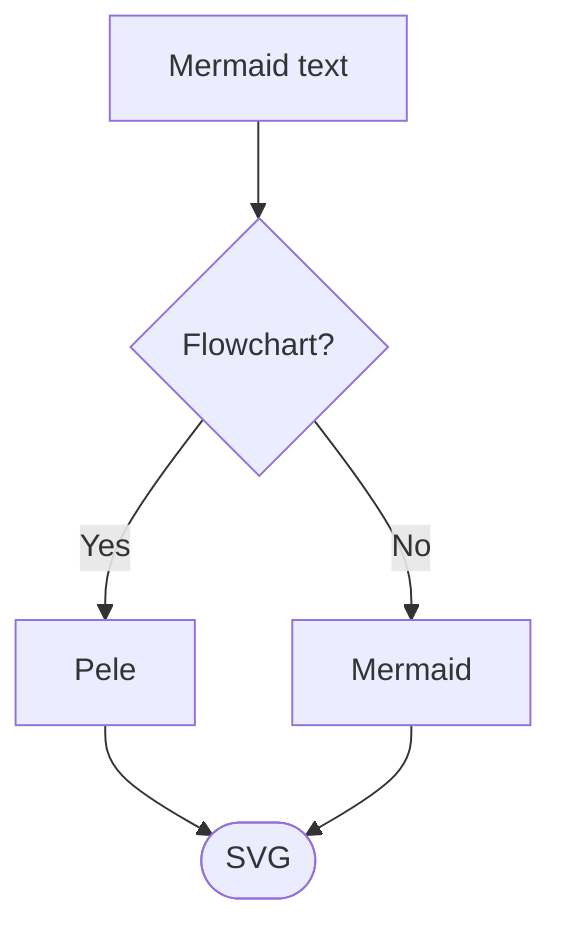

# Markdown-react
A simple markdown editor and previewer based on react and markdown

## Features:
1) Supports headings (h1-h6)
2) Paragraphs
3) Lists
4) [Links](http://google.com)
5) **Bold** text
6) *Italics* text
7) Code blocks using shiki
8) Inline `code` using backticks

## Code block
```js
function Test() {
  console.log("Hello, world");
}
```

## Blockquote
> I wish to speak a word for Nature, for absolute freedom and wildness, as contrasted with a freedom and culture merely civil, — to regard man as an inhabitant, or a part and parcel of Nature, rather than a member of society.  

## Images 


## Tables

| Tables        | Are           | Cool  |
| ------------- |:-------------:| -----:|
| col 3 is      | right-aligned | $1600 |
| col 2 is      | centered      |   $12 |
| zebra stripes | are neat      |    $1 |

## Mermaid diagrams

